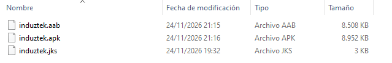

# InduztekApp

Aplicación Android para registrar en terreno los protocolos de prueba y mantención de equipos eléctricos (transformadores, relés de protección, celdas, cables) de **Induztek Ingeniería SpA**. Permite dejar un registro estructurado de cada prueba en el momento en que se realiza y consultar el historial de cada equipo, incluso sin conexión.

Proyecto de la asignatura **DSY1105 – Desarrollo de Aplicaciones Móviles** (Duoc UC), Evaluaciones Parciales 4 y 5 (Evaluación Sumativa 3). Todos los datos son ficticios.

Backend (microservicios Spring Boot): [DemoInduztek-microservicio](https://github.com/Pedro420-z/DemoInduztek-microservicio)

## Funcionalidades

- Inicio de sesión contra `usuarios-service` (con modo sin conexión para el último usuario que ingresó en el teléfono).
- Cambio obligatorio de la contraseña temporal en el primer ingreso.
- El Jefe Técnico crea los usuarios (elige el rol; la contraseña temporal la genera el servidor y se envía por correo).
- Técnico e Ingeniero pueden crear clientes e instalaciones.
- El Jefe Técnico ve el perfil de cada trabajador (rol, RUT, correo, teléfono y estado) y puede activar o desactivar sus cuentas desde el menú **Trabajadores**.
- Cuatro perfiles: Técnico, Ingeniero, Jefe Técnico y Cliente.
- Alta de equipos con TAG, tipo, datos de placa y foto de la placa. Solo el Jefe Técnico puede editar un equipo; los equipos no se eliminan.
- Creación de protocolos y registro de mediciones por prueba (aislación, TTR, devanados, contactos, operación de relé), con resultado calculado al instante.
- Validación de instrumentos (se bloquean los de calibración vencida) y de rangos de medida.
- Cierre de visita con acta y datos de quien recibe.
- Revisión del protocolo: formalizar, observar o anular, con motivo obligatorio.
- Historial de protocolos por equipo. Protocolos, visitas y actas no se eliminan; solo se puede eliminar una prueba de un protocolo, tras tres advertencias.
- Sugerencia de temperatura y humedad ambiente desde una API externa de clima (Open-Meteo), que el técnico puede corregir antes de guardar.
- Trabajo sin conexión: lo que se registra sin red queda en una cola local y se sincroniza solo al volver la conexión.
- Perfil Cliente: solo ve los equipos, visitas y actas de su propia empresa. Ve todos sus protocolos salvo borradores y anulados; los observados y los aún no formalizados aparecen como "Pendiente de formalización".

## Recursos del dispositivo

- **Cámara**: fotografía de la placa del equipo (permiso `CAMERA`, `FileProvider`).
- **Estado de red**: indicador de conectividad (`ConnectivityManager`).

## Tecnologías

- Kotlin, Jetpack Compose y Material Design 3
- Arquitectura MVVM (`ViewModel`, `StateFlow`)
- Navigation Compose
- Los datos viven en los microservicios (MySQL). En el teléfono solo se guardan la sesión (`SharedPreferences`), una caché de consultas y la cola de operaciones pendientes (archivos JSON)
- Retrofit, OkHttp y Gson para consumir los microservicios propios y la API externa de clima (Open-Meteo)

## Requisitos

- Android Studio actualizado (con soporte para `compileSdk`/`targetSdk` 37)
- JDK 11 o superior (el JDK integrado de Android Studio sirve)
- Dispositivo o emulador con Android 8.0 (API 26) o superior
- Conexión a internet la primera vez, para que Gradle descargue las dependencias
- Los microservicios corriendo en el PC (ver el repositorio del backend) y Laragon con MySQL encendido

## Cómo ejecutarla

1. Clonar el repositorio: `git clone https://github.com/eldeldeldede/InduztekApp.git`
2. Abrir la carpeta en Android Studio y esperar la sincronización de Gradle.
3. Encender MySQL en Laragon y levantar Eureka, los microservicios y el API Gateway (`iniciar-servicios.bat`, o los pasos del README del backend).
4. Elegir un emulador y presionar **Run**.

La app se conecta al PC desde el emulador por `10.0.2.2` (API Gateway en el puerto 8080, definido en `network/ApiConfig.kt`; el gateway reparte las llamadas a los microservicios). El proyecto usa `targetSdk = 36`: con Android 17 y `targetSdk` 37 el acceso a direcciones de red local requiere un permiso adicional.

Al primer arranque del backend se cargan datos de ejemplo (empresas, usuarios, instrumentos, equipos y actas).

## Endpoints utilizados

### API externa (Open-Meteo, sin clave)

Se consume con Retrofit (`network/ClimaApi.kt`) directamente por https, sin pasar por el gateway ni guardar datos en nuestra base. Se usa en la pantalla del protocolo, botón **Sugerir según el clima actual**.

| Método | URL | Uso |
| --- | --- | --- |
| GET | `https://api.open-meteo.com/v1/forecast?latitude=-33.45&longitude=-70.66&current=temperature_2m,relative_humidity_2m` | Temperatura y humedad actuales para precargar las condiciones ambientales |

### Microservicios propios (vía API Gateway `http://10.0.2.2:8080`)

| Servicio | Método y ruta |
| --- | --- |
| usuarios-service (8081) | `GET /api/roles`, `GET /api/usuarios`, `GET /api/usuarios/{id}`, `POST /api/usuarios`, `POST /api/usuarios/login`, `PUT /api/usuarios/{id}`, `PUT /api/usuarios/{id}/contrasena`, `PUT /api/usuarios/{id}/estado`, `POST /api/usuarios/recuperacion`, `POST /api/usuarios/recuperacion/confirmar` |
| equipos-service (8082) | `GET /api/regiones`, `GET /api/comunas`, `GET /api/tipos-equipo`, `GET/POST /api/equipos`, `GET/PUT /api/equipos/{id}`, `GET/POST /api/instalaciones`, `GET/PUT /api/instalaciones/{id}` |
| protocolos-service (8083) | `GET /api/tipos-prueba`, `GET/POST /api/instrumentos`, `GET/PUT /api/instrumentos/{id}`, `GET/POST /api/instrumentos/{id}/calibraciones`, `GET/POST /api/protocolos`, `GET/PUT /api/protocolos/{id}`, `POST /api/protocolos/{id}/pruebas`, `DELETE /api/protocolos/{id}/pruebas/{pruebaId}`, `POST /api/protocolos/{id}/registrar`, `POST /api/protocolos/{id}/observar`, `POST /api/protocolos/{id}/formalizar`, `POST /api/protocolos/{id}/anular`, `GET/POST /api/visitas`, `GET /api/visitas/{id}`, `POST /api/visitas/{id}/cierre`, `POST /api/visitas/{id}/recepcion` |
| reportes-service (8084) | `GET /api/reportes/equipos`, `GET /api/reportes/equipos/{id}/historial`, `GET /api/reportes/actas`, `GET /api/reportes/protocolos-atrasados` |

La documentación interactiva (Swagger/OpenAPI) de cada servicio está en `http://localhost:<puerto>/swagger-ui.html`.

## Usuarios

Contraseña de todos: `Induztek2026` (temporal: la app pide cambiarla en el primer ingreso).

| Perfil | Correo |
| --- | --- |
| Jefe Técnico | jefe@induztek.cl |
| Ingeniero | camila.rojas@induztek.ejemplo |
| Técnico | diego.soto@induztek.ejemplo |
| Cliente | mfuentes@envpacifico.ejemplo |
| Cliente | tleiva@losaromos.ejemplo |

Los demás usuarios los crea el Jefe desde el menú (**Crear usuario**). La contraseña temporal llega al correo del nuevo usuario por Gmail (ver el README del backend).

## Firma de la aplicación (APK y .jks)

La app se firma en modo release con un almacén de claves propio (`induztek.jks`, alias `induztek`). Los archivos generados están en la carpeta [`distribucion/`](distribucion/): `induztek.apk`, `induztek.aab` e `induztek.jks`.

Pasos para generarlos en Android Studio:

1. **Build → Generate Signed App Bundle or APK…**
2. Elegir **Android App Bundle** y *Next*.
3. En *Key store path* elegir **Create new…**, guardar `induztek.jks`, definir las contraseñas del almacén y de la clave, el alias `induztek` y los datos del certificado.
4. Elegir la variante **release** y *Create*: el `.aab` queda en `app/release/`.
5. Repetir el asistente eligiendo **APK**, con el mismo `.jks` y la variante **release**.
6. Instalar `app-release.apk` en el emulador para comprobar que abre y se conecta a los microservicios.

Captura del APK firmado y del `.jks`:



## Estructura

```
app/src/main/java/cl/induztek/app/
├── data/          Sesión y seguridad
├── local/         Cola de operaciones pendientes y almacenamiento sin conexión
├── network/       Retrofit: cliente, direcciones, DTOs y resultados de red
├── repository/    Acceso a los microservicios, caché y sincronización
├── model/         Entidades y estados de pantalla
├── validacion/    Reglas de negocio y validaciones en Kotlin puro
├── viewmodel/     ViewModels de cada pantalla
├── navigation/    Rutas y grafo de navegación
├── ui/            Pantallas, componentes reutilizables y tema
└── util/          Utilidades (fotos de placa, conexión)
```

## Pruebas

14 pruebas unitarias en Kotlin puro (JUnit 4), repartidas en 4 archivos: criterios de resultado (incluye la conversión de la API de clima), validación de RUT, validaciones de recuperación y almacenamiento local, en `app/src/test`. Se ejecutan desde Android Studio: clic derecho en `app/src/test` → *Run Tests*.

Las pruebas eléctricas se modelan con una jerarquía sellada (`PruebaElectrica`) cuyas subclases implementan cada una su propia evaluación y validación de parámetros (herencia y polimorfismo). Las reglas de validación de formularios están centralizadas en `ValidacionesFormulario`.

## Integrantes

- Gonzalo Bahamondes ([@eldeldeldede](https://github.com/eldeldeldede))
- Pedro Cid ([@Pedro420-z](https://github.com/Pedro420-z))

Tablero de trabajo: [Trello](https://trello.com/b/SjTLmmp4/proyecto-aplicaciones-moviles)
